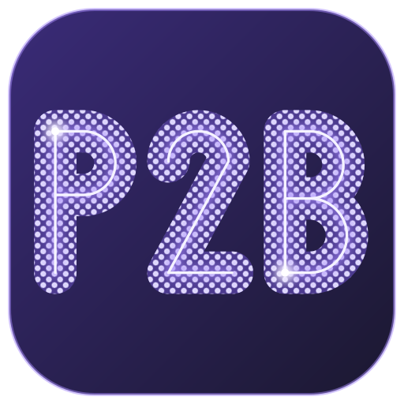

<p align="center"></p>

# Pix2Burn

A free, open-source tool to **prepare images and photos for laser engraving**, then **generate G-code and send it to a GRBL machine**: real-world size, cropping, dithering, image export, G-code and USB control. It runs in your browser or as a desktop app.

[Version française](README.md)

## Why this tool

A photo sent as-is to a laser often comes out dull or muddy. Pix2Burn turns it into a black-and-white (or grayscale) image suited to your material, size and engraving resolution, and can then engrave it directly.

Everything runs **on your computer**: your image is never uploaded anywhere.

## Installation

**Desktop app (Windows, macOS, Linux).** Download the installer for your system from the repository's **Releases** page: `.exe` (Windows), `.dmg` (macOS), `.AppImage` or `.deb` (Linux). It is the same app in its own window, and USB control works on every system without choosing a browser.

- **Windows**: SmartScreen may warn about an unsigned app. Click "More info", then "Run anyway".
- **macOS**: the app is not signed by Apple. Right-click the app, choose "Open", then confirm. The current installers work from macOS 12 (Monterey) onwards.
- **Linux**: your user must be allowed to use serial ports (usually the `dialout` group). On recent Ubuntu versions, if the AppImage does not start, run it with `--no-sandbox` or install the `.deb` instead.
- Depending on your board, a USB-serial driver (such as CH340) may be needed on Windows or macOS.

**In a browser.** Open `index.html` in a recent browser. See "Requirements" below for USB control.

## Usage

Follow the three tabs in the header:

- **1 · Image**: load the image, pick a material preset, set the size, crop, tones and dithering. You can export the image as PNG, BMP or JPEG.
- **2 · G-code**: set speed, power and overscan, then save the G-code file.
- **3 · Machine**: connect the laser over USB, position it, trace the frame and start the engraving.

Rule of thumb: in the produced image, **black means the laser fires**. Some laser programs invert this convention, so check with a test piece.

## Features

**Image**
- Load via file picker or drag and drop
- Engraving size as **width × height** in mm, with a "keep proportions" option
- Resolution from 127 to 508 dpi (0.20 mm down to 0.05 mm line spacing)
- Interactive **cropping**, quarter-turn rotation and straightening from -45° to +45°
- Brightness, contrast, gamma and sharpening controls
- Dithering: Floyd-Steinberg, Atkinson, Jarvis-Judice-Ninke, Stucki, ordered (Bayer 4×4), simple threshold, grayscale with no dithering
- Invert and horizontal mirror
- **Material presets**: light wood, dark wood or MDF, leather, cardboard and paper, slate and stone, glass, acrylic (back engraving), anodized aluminum
- Preview with zoom: fitted to the window by default, + and − buttons, 100% (1 pixel = 1 point), Ctrl/⌘ + wheel, drag to pan
- Export as PNG, 1-bit BMP, 8-bit BMP, 24-bit BMP or JPEG (BMP files embed the chosen resolution)

**G-code**
- Line-by-line raster scan, grouping consecutive dots to keep files small
- Speed (mm/min), power (%), S max, line overscan, multiple passes, bidirectional scanning, dynamic mode M4, Y-axis inversion
- **Dry run** (laser off) and estimated duration
- Zero at the bottom-left corner of the image

**Machine (USB, GRBL)**
- Direct connection (Web Serial API), reads the machine settings
- Jogging, work zero, go to zero, unlock
- **Home** using limit switches, with automatic return to Home after engraving
- Frame tracing, start, pause and resume, progress bar
- **STOP** button always visible in the header
- Collapsible GRBL console for commands and machine replies

## Requirements

- **Desktop app**: nothing else is needed.
- **Browser**: Chrome or Edge (the Web Serial API is required for USB control). Firefox supports it from version 151, according to Mozilla. Safari does not: image and G-code export still work everywhere.
- **Machine**: **GRBL** controller over USB (115200 baud) with laser mode enabled (`$32=1`). For Home: limit switches installed and `$22=1`. Developed and tested with a Sculpfun S6 Pro diode laser.

## Known limitations

- Presets are **rough starting points**: always test on a scrap piece. They tune the image only, not laser power or speed.
- Only image scanning (raster) is supported: no vector work or cutting.
- Direct sending only works with GRBL machines (not Ruida, Marlin or proprietary protocols). The G-code file can still be loaded in other programs.
- The exported PNG is a color (RGBA) file, not a 1-bit PNG.
- 1-bit BMP applies a 50% threshold: to keep grayscale levels, use 8-bit BMP.
- JPEG is not recommended after dithering, as compression damages the dots.
- Size is capped at 4000 points in width or height. A heavily dithered image at high resolution produces many segments, which can make the machine stutter: lower the resolution if needed.

## Safety

Laser engraving carries risks (eyes, fire, fumes). Follow your machine's instructions, wear suitable protective glasses, ventilate, and **never leave the laser unattended**. Never engrave PVC or vinyl: they release toxic gases.

Before a first engraving, run a **dry run** and trace the frame. The STOP button resets the machine immediately. Pix2Burn only prepares and sends what you ask for: choosing the settings remains your responsibility.

## Building the installers

The desktop app uses [Electron](https://www.electronjs.org/) around the same `index.html`.

```
npm install     # install dependencies
npm start       # run the desktop app
npm run dist    # build the installer for your system (in dist/)
```

To build the Windows, macOS and Linux installers at once, push a tag such as `v0.1.0`: the GitHub Actions workflow in `.github/workflows/build.yml` builds them and attaches them to a Release.

Electron is deliberately pinned to **version 43**, the last series that supports macOS 12 (Monterey): later ones require macOS 13 or newer. Its support ends in January 2027. The app only loads its own local file, which limits the risk, but you should then either move to a newer version (dropping Monterey) or keep the browser version for those Macs.

## Contributing

Feedback, ideas and fixes are welcome through the repository's Issues and Pull requests, especially test reports on materials and other GRBL machines.

Ideas for the future: native 1-bit PNG, saving settings, more presets, engraving preview simulation, more languages.

## License

Released under the MIT License: see the [LICENSE](LICENSE) file. The logo (`logo.svg`) is released under the same license. The software is provided "as is", without warranty.

## Credits

The dithering algorithms used are classic, long-published methods: Floyd-Steinberg, Atkinson, Jarvis-Judice-Ninke, Stucki and Bayer. Pix2Burn is an independent project and is not affiliated with any other engraving or image-preparation software.

Author: [YOUR NAME] — [REPOSITORY-URL]
