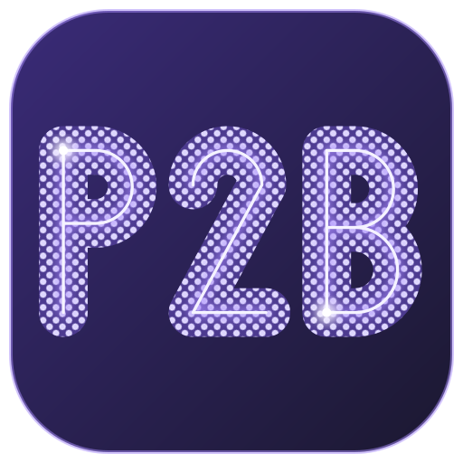

<p align="center"></p>

# Pix2Burn

Outil libre et gratuit, utilisable dans le navigateur ou comme logiciel de bureau, pour **préparer des images et des photos pour la gravure laser**, puis **générer le G-code et l'envoyer à une machine GRBL** : taille réelle, recadrage, tramage (dithering), export d'image, G-code et pilotage par USB.

[English version](README.en.md)

## Pourquoi cet outil

Une photo envoyée telle quelle à un laser donne souvent un résultat terne ou empâté. Pix2Burn la transforme en une image en noir et blanc (ou en niveaux de gris) adaptée au matériau, à la taille et à la résolution de votre gravure, puis peut la graver directement.

Tout se passe **sur votre ordinateur** : l'image n'est envoyée nulle part.

## Installation

**Logiciel de bureau (Windows, macOS, Linux).** Téléchargez l'installateur de votre système dans la page **Releases** du dépôt : `.exe` (Windows), `.dmg` (macOS), `.AppImage` ou `.deb` (Linux). C'est la même application dans sa propre fenêtre, et le pilotage USB fonctionne sur tous les systèmes sans avoir à choisir un navigateur.

- **Windows** : SmartScreen peut signaler une application non signée. Cliquez sur « Informations complémentaires », puis « Exécuter quand même ».
- **macOS** : l'application n'est pas signée par Apple. Faites un clic droit sur l'application, choisissez « Ouvrir », puis confirmez. Les installateurs actuels fonctionnent à partir de macOS 12 (Monterey).
- **Linux** : votre utilisateur doit avoir le droit d'utiliser les ports série (en général le groupe `dialout`). Sur les versions récentes d'Ubuntu, si l'AppImage ne démarre pas, lancez-la avec `--no-sandbox` ou installez plutôt le `.deb`.
- Selon la carte de votre machine, un pilote USB-série (par exemple CH340) peut être nécessaire sous Windows ou macOS.

**Dans un navigateur.** Ouvrez simplement `index.html` dans un navigateur récent (voir « Prérequis » pour le pilotage USB).

## Utilisation

Suivez les trois onglets du bandeau :
   - **1 · Image** : chargez l'image, choisissez un préréglage de matériau, la taille, le recadrage, les tons et le tramage. Vous pouvez exporter l'image en PNG, BMP ou JPEG.
   - **2 · G-code** : réglez vitesse, puissance et dépassement, puis enregistrez le fichier G-code.
   - **3 · Machine** : connectez le laser en USB, positionnez-le, tracez le cadre et lancez la gravure.

Repère utile : dans l'image produite, **le noir correspond aux zones gravées par le laser**. Certains logiciels de laser inversent cette convention : vérifiez avec un essai.

## Fonctionnalités

**Image**
- Chargement par sélecteur de fichier ou glisser-déposer
- Taille de gravure **largeur × hauteur** en mm, avec option « conserver les proportions »
- Résolution de 127 à 508 dpi (de 0,20 mm à 0,05 mm entre deux lignes)
- **Recadrage** interactif, rotation par quarts de tour et redressement de -45° à +45°
- Réglages de luminosité, contraste, gamma et netteté
- Tramage : Floyd-Steinberg, Atkinson, Jarvis-Judice-Ninke, Stucki, ordonné (Bayer 4×4), seuil simple, niveaux de gris sans tramage
- Inversion et miroir horizontal
- **Préréglages de matériaux** : bois clair, bois foncé ou MDF, cuir, carton et papier, ardoise et pierre, verre, acrylique (gravure par l'arrière), aluminium anodisé
- Aperçu avec zoom : ajusté à la fenêtre par défaut, boutons + et −, 100 % (1 pixel = 1 point), Ctrl/⌘ + molette, déplacement à la souris
- Export en PNG, BMP 1 bit, BMP 8 bits, BMP 24 bits ou JPEG (les BMP embarquent la résolution choisie)

**G-code**
- Balayage ligne par ligne, avec regroupement des points consécutifs pour garder des fichiers légers
- Vitesse (mm/min), puissance (%), S max, dépassement en bout de ligne, passes multiples, balayage aller-retour, mode dynamique M4, inversion de l'axe Y
- **Test à blanc** (laser éteint) et estimation de la durée
- Zéro au coin bas-gauche de l'image

**Machine (USB, GRBL)**
- Connexion directe depuis le navigateur (API Web Serial), lecture des réglages de la machine
- Déplacements, définition du zéro pièce, retour au zéro, déverrouillage
- **Home** avec les fins de course, et retour automatique au Home après la gravure
- Tracé du cadre, lancement, pause et reprise, barre de progression
- Bouton **ARRÊT** toujours visible dans le bandeau
- Console GRBL repliée pour les commandes et les réponses de la machine

## Prérequis

- **Logiciel de bureau** : rien d'autre à installer.
- **Navigateur** : Chrome ou Edge (l'API Web Serial est nécessaire pour l'envoi USB). Firefox la gère à partir de la version 151 selon Mozilla. Safari ne la gère pas : l'export d'image et de G-code reste utilisable partout.
- **Machine** : contrôleur **GRBL** en USB (115200 bauds), avec le mode laser activé (`$32=1`). Pour le Home : fins de course installés et `$22=1`. Développé et testé avec un graveur à diode Sculpfun S6 Pro.

## Limites connues

- Les préréglages sont des **points de départ approximatifs** : faites toujours un essai sur une chute de matériau. Ils règlent l'image, pas la puissance ni la vitesse du laser.
- Seul le balayage d'images (raster) est géré : pas de vectoriel ni de découpe.
- L'envoi direct ne concerne que les machines GRBL (pas Ruida, Marlin ni les protocoles propriétaires). Le fichier G-code peut en revanche être chargé dans d'autres logiciels.
- Le PNG exporté est en couleur (RGBA), pas un PNG 1 bit.
- Le BMP 1 bit applique un seuil à 50 % : pour garder des niveaux de gris, utilisez le BMP 8 bits.
- Le JPEG est déconseillé après tramage, la compression abîme les points.
- La taille est plafonnée à 4000 points en largeur ou en hauteur. Une image très tramée à haute résolution produit beaucoup de segments, ce qui peut faire saccader la machine : réduisez la résolution si besoin.

## Sécurité

La gravure laser présente des risques (yeux, incendie, fumées). Respectez les consignes de votre machine, portez les lunettes de protection adaptées, ventilez, et **ne laissez jamais le laser sans surveillance**. Ne gravez jamais de PVC ou de vinyle : ils dégagent des gaz toxiques.

Avant une première gravure, faites un **test à blanc** et tracez le cadre. Le bouton ARRÊT réinitialise immédiatement la machine. Pix2Burn ne prépare et n'envoie que ce que vous lui demandez : le choix des réglages reste de votre responsabilité.

## Construire les installateurs

Le logiciel de bureau utilise [Electron](https://www.electronjs.org/) autour du même `index.html`.

```
npm install     # installe les dépendances
npm start       # lance le logiciel de bureau
npm run dist    # construit l'installateur de votre système (dans dist/)
```

Pour construire d'un coup les installateurs Windows, macOS et Linux, poussez une étiquette (tag) du type `v0.1.0` : le workflow GitHub Actions de `.github/workflows/build.yml` les construit et les joint à une Release.

Electron est volontairement figé en **version 43**, la dernière série compatible avec macOS 12 (Monterey) : les suivantes demandent macOS 13 ou plus. Son support prend fin en janvier 2027. L'application ne charge que son propre fichier local, ce qui limite le risque, mais prévoyez ensuite soit de passer à une version plus récente (en abandonnant alors Monterey), soit de conserver la version navigateur pour ces Mac.

## Contribuer

Les retours, idées et corrections sont les bienvenus via les « Issues » et les « Pull requests » du dépôt, notamment des retours d'essais sur des matériaux et d'autres machines GRBL.

Pistes d'évolution : PNG 1 bit natif, sauvegarde des réglages, nouveaux préréglages, simulation de l'aperçu de gravure, autres langues.

## Licence

Distribué sous licence MIT : voir le fichier [LICENSE](LICENSE). Le logo (`logo.svg`) est distribué sous la même licence. Le logiciel est fourni « tel quel », sans garantie.

## Crédits

Les algorithmes de tramage utilisés sont des méthodes classiques, publiées de longue date : Floyd-Steinberg, Atkinson, Jarvis-Judice-Ninke, Stucki et Bayer. Pix2Burn est un projet indépendant, sans lien avec aucun autre logiciel de gravure ou de préparation d'images.

Auteur : Didier 

